# SHINE Platform — Comprehensive UI/UX Audit & Design Direction (Phase 0)

> **Branch:** `redesign/ui-v2`  
> **Status:** Phase 0 Complete — Awaiting Approval  
> **Framework & Stack:** Next.js 16.3.4 (App Router), React 19, Tailwind v4, Prisma 6, PostgreSQL, NextAuth 4, lucide-react, three + @react-three/fiber, html5-qrcode.

---

## 1. Executive Summary & Quantitative Debt Baseline

A forensic audit of the existing codebase on `dev` reveals heavy visual and architectural debt resulting from organic, rapid feature accretion. Below are the audited baseline metrics:

### 1.1 Quantitative Codebase Debt (Measured)
| Metric | Current Count | Target (Post-Redesign) | Root Cause & Problem |
| :--- | :--- | :--- | :--- |
| **Hardcoded Hex Values** | **~1,290 instances** (83 distinct hexes) | **0 outside tokens** | Fragmented styling across `#FAF8F5`, `#1C1917`, `#FF6B1A`, `#D9A441`, `#F8FAFC`, `#0B0A0A`, `#00E5FF`, `#E7E5E4`, `#57534E`, etc. |
| **Arbitrary Font Sizes (`text-[Npx]`)** | **~640 instances** | **0** | Missing type scale; arbitrary sizes from `text-[9px]` to `text-[55px]` without baseline grid. |
| **Two Disconnected Themes** | **2 parallel worlds** | **1 unified token system** | Public/fest uses warm cream (`#FAF8F5`, ember `#FF6B1A`, gold `#D9A441`); dashboards use slate (`#F8FAFC`, `#0F172A`); wayfinding uses pitch black (`#0B0A0A`, cyan `#00E5FF`). |
| **Decorative Gradients** | **~80 gradients** | **0** | Wordmark gradients, rainbow card top-borders, sunburst blurs, ambient radial flares. |
| **Large Radii & Heavy Shadows** | **~686 radii / ~212 shadows** | **Hairline borders; 8px controls, 12px panels** | Inconsistent corner rounding (`rounded-3xl`, `rounded-2xl`, `rounded-full`) and multi-layer drop shadows (`shadow-2xl`, `shadow-orange-500/40`). |
| **Extreme Weights & Letter-Spacing** | **~374 font-black / ~311 uppercase tracking** | **Max 600 UI, 700 display; sentence-case** | Overuse of `font-black` and `uppercase tracking-[0.3em]` destroys hierarchy and readability. |
| **Looping Animations & Effects** | **~87 pulse/ping/spin/glows** | **0 decorative looping animations** | `ParticleField` canvas, `animate-pulse-glow`, `animate-sonar`, `animate-laser` causing GPU load and distracting from content. |
| **Raw Emojis in TSX** | **97 emoji instances** | **0 (Lucide icons only)** | Emojis (`⚡`, `🛡️`, `🌿`, `🍗`, `🚻`, `💧`, `☕`, `ℹ️`) render inconsistently across Android, iOS, Windows, and Linux. |
| **Giant Monolith Files (>400 lines)** | **10 files (20,296 lines total)** | **0 files > 400 lines** | `admin/page.tsx` (7,422), `admin/reports/page.tsx` (2,180), `food/page.tsx` (1,878), `register/page.tsx` (1,758), `CheckInModal.tsx` (1,712), `coordinator/[eventId]/page.tsx` (1,509), `admin/events/page.tsx` (1,375), `InteractiveFloorPlanModal.tsx` (1,279), `Venue3D.tsx` (969), `emailService.ts` (1,456). |
| **Accessibility Deficits** | **~22 aria-* and 5 role= in 51 files** | **WCAG AA / 98+ Lighthouse** | Tabs are unsemantic `<div>`/`<button>`; 12 raw `` tags missing Next.js optimizations; lacking focus rings and keyboard traps. |
| **Hardcoded Copy** | **Dozens of strings** | **0 hardcoded user copy** | Hardcoded dates ("Sept 17, 2026"), timings ("09:00 AM"), rule titles, institutional descriptions, email bodies bypass database models. |

---

## 2. Component Inventory & Duplication Map

Audit of duplicated UI logic across routes:

| Component / Pattern | Files Where Duplicated | Current Implementation | Redesign Strategy (Phase 2 UI Library) |
| :--- | :--- | :--- | :--- |
| **QR Code Scanner** | `food/page.tsx`, `CheckInModal.tsx`, `coordinator/[eventId]/page.tsx` | Redundant `html5-qrcode` initialization, camera permission handling, device switcher, and torch toggle copy-pasted across 3 files. | Single headless scanner primitive `src/components/ui/QrScanner.tsx` (< 250 lines) with mobile-first viewport. |
| **Data Tables** | `admin/events`, `admin/users`, `admin/reports`, `admin/logs`, `coordinator/[eventId]`, `food` | 6 bespoke HTML `<table>` implementations with non-standard sorting, lack of sticky headers, unaligned column widths, no keyboard navigation. | Unified `DataTable.tsx` component with sticky headers, compact row density, filter bar, pagination, and mobile card fallback. |
| **Indoor Map & Floor Plan** | `InteractiveFloorPlanModal.tsx`, `dashboard`, `badge/[badgeCode]`, `loc/[waypointId]`, `admin/page.tsx` | 1,279-line modal duplicated across multiple entry points, managing both 2D SVG pan-zoom and 3D Canvas simultaneously. | Split into `FloorPlanModal.tsx` (modal shell), `FloorPlanSvg2D.tsx` (clean SVG zoom/pan), and dynamic-imported `Venue3D.tsx` with WebGL fallback. |
| **Toast & Alerts** | `ToastProvider.tsx`, custom alert boxes in `register`, `login`, `coordinator` | Floating custom banner system with hardcoded hex styles and emoji icons. | Accessible `Toast.tsx` with Radix-like behavior, semantic status tokens, and ARIA live region support. |
| **Status Badges** | `EventCard`, `dashboard`, `coordinator`, `admin/events`, `badge` | 5 variations of `.status-badge`, `.badge-confirmed`, `.badge-pending` using conflicting green, amber, red, and purple shades. | Canonical `StatusBadge.tsx` with semantic token values (`status-confirmed`, `status-pending`, `status-rejected`). |
| **Modal / Dialog** | `CheckInModal`, `PrintableQrModal`, `InteractiveFloorPlanModal`, admin drawers | Fixed-position full-screen `<div>` overlays lacking focus trap, `Esc` key handling, and background inerting. | Native `<dialog>` element with accessible focus management and backdrop blur. |
| **Metric / KPI Cards** | `page.tsx`, `dashboard`, `profile`, `food`, `admin`, `coordinator` | Custom flex containers with varying padding, arbitrary numbers, and inconsistent icon boxes. | Standardized `Stat.tsx` component with label, value, trend, and optional icon. |

---

## 3. Revised Role-Based Information Architecture & Sitemap

```mermaid
graph TD
  subgraph PublicTier ["Public & Visitor Tier"]
    P_Home["/ (Landing Page)"]
    P_Events["/events (Filterable Directory)"]
    P_Register["/register (4-Step Delegation Stepper)"]
    P_Login["/login (Focused Auth)"]
    P_Leaderboard["/leaderboard (16:9 Stage View)"]
    P_Badge["/badge/:code (Digital Pass & Print)"]
    P_Loc["/loc/:waypointId ('You Are Here' Wayfinding)"]
  end

  subgraph StudentTier ["Student Portal Tier (Role: STUDENT)"]
    S_Dash["/dashboard (Next Event Hero > Passes > My Arenas)"]
    S_Profile["/profile (Identity & Security)"]
  end

  subgraph CoordinatorTier ["Coordinator Operations Tier (Role: COORDINATOR)"]
    C_Hub["/coordinator (Assigned Arenas)"]
    C_Console["/coordinator/:id (Participants • Prelims • Scoring)"]
  end

  subgraph FoodTier ["Food Operations Tier (Role: FOOD_COORDINATOR)"]
    F_Scan["/food (Full-Screen Optical Scanner + Giant Single State)"]
  end

  subgraph AdminTier ["Administration Tier (Role: ADMIN)"]
    A_Dash["/admin (Overview KPI & Health)"]
    A_Inst["/admin/institution (Setup 1-5 + Floor Plan)"]
    A_Editions["/admin/editions (Edition Lifecycle)"]
    A_Branding["/admin/branding (Identity, CTA, Theme, Navigation, Schedule)"]
    A_Email["/admin/email (Action Triggers, SMTP, Templates)"]
    A_Regs["/admin/registrations (Dossiers & Desk Approvals)"]
    A_Events["/admin/events (Dense Event Table & Drawer)"]
    A_Users["/admin/users (Directory & RBAC)"]
    A_Reports["/admin/reports (Magazine-Grade Reports & Print)"]
    A_Logs["/admin/logs (Filterable Audit Log)"]
    A_Design["/design (Design System Showcase)"]
  end

  P_Login -->|STUDENT| S_Dash
  P_Login -->|COORDINATOR| C_Hub
  P_Login -->|FOOD_COORDINATOR| F_Scan
  P_Login -->|ADMIN| A_Dash
```



---

## 4. Screen-by-Screen Deep Audit & Proposed ASCII Wireframes

---

### SCREEN 1: Public Landing Page (`/`)
- **Primary Role:** Public Visitor, Prospective Delegate, Faculty Advisor.
- **Single Main User Job:** Understand symposium date, venue, and prestige, explore the 12 competitions, and click "Register Contingent".
- **Current Defects:**
  - *Hierarchy:* 7,000px height with competing focal points. Hero buried beneath 80 canvas particles, huge glowing sunbursts, and pulsing logo containers.
  - *Density:* Giant gaps (`py-24`, `mb-16`) cause excessive scrolling.
  - *Consistency:* Wordmark uses a 3-stop gradient; buttons use ember gradients and glow box-shadows.
  - *Accessibility:* Jumping heading levels (`<h1>` straight to `<h3>`); text contrast on muted descriptions is borderline WCAG AA.
  - *Hardcoded Copy:* Event dates, rules, prizes, and quotes hardcoded in `page.tsx` instead of reading from `EventEdition`.
- **Proposed Layout (ASCII Wireframe):**

```text
+-----------------------------------------------------------------------------------+
| [SHINE '26]    About    Schedule    Competitions    Rules    Contact    [REGISTER] |
+-----------------------------------------------------------------------------------+
|                                                                                   |
|  Sacred Heart College (Autonomous), Tirupattur • Dept. of Computer Applications  |
|                                                                                   |
|  SHINE 2026                                                                       |
|  Annual National Intercollegiate IT Symposium                                    |
|  Thursday, September 17, 2026 • SGB Main Auditorium                               |
|                                                                                   |
|  [ 08d : 14h : 22m : 10s until Inauguration ]                                    |
|                                                                                   |
|  [ Register Contingent -> ]               [ Explore Competitions (12) ]           |
|                                                                                   |
+-----------------------------------------------------------------------------------+
| SYMPOSIUM AT A GLANCE                                                             |
| +-------------------+ +-------------------+ +-------------------+ +---------------+ |
| | 12 Competitions   | | ₹25,000+ Prizes   | | 500+ Expected     | | NAAC A++      | |
| | On & Off Stage    | | Cash + Trophies   | | 40+ Colleges      | | 3.53 CGPA     | |
| +-------------------+ +-------------------+ +-------------------+ +---------------+ |
+-----------------------------------------------------------------------------------+
| TIMELINE & SCHEDULE                                              [Projector Mode] |
| 08:30 AM  Delegate Check-in & Breakfast               • SGB Quadrangle            |
| 09:30 AM  Inauguration & Keynote Address              • Main Auditorium           |
| 10:30 AM  Preliminary Rounds & Off-Stage Arenas Begin • Tech Block Labs           |
| 01:00 PM  Symposium Lunch Banquet (Veg / Non-Veg)     • Dining Hall               |
| 03:30 PM  Grand Valedictory & Championship Trophies   • Main Auditorium           |
+-----------------------------------------------------------------------------------+
| FEATURED COMPETITIONS                                            [View All 12 ->] |
| +---------------------------+ +---------------------------+ +---------------------+ |
| | Code Crunch (Off-Stage)   | | Tech Talk (On-Stage)      | | Web Weaver (Off)    | |
| | Lab 3 • 2 Members         | | Main Stage • Solo         | | Lab 1 • Solo        | |
| | ₹5,000 Cash + Trophy      | | ₹5,000 Cash + Trophy      | | ₹4,000 Cash + Trophy| |
| | [Rules & Prelims]         | | [Rules & Topics]          | | [Rules & Tools]     | |
| +---------------------------+ +---------------------------+ +---------------------+ |
+-----------------------------------------------------------------------------------+
| SYMPOSIUM GUIDELINES (3 Core Rules from DB)                                       |
| 1. Eligibility: Bona fide CS/IT UG & PG students with valid college ID.           |
| 2. Limit: Maximum 2 events per delegate; 1 prelims nomination per college.        |
| 3. Championship: Decided by cumulative aggregate points across all events.        |
+-----------------------------------------------------------------------------------+
| SPONSORS & PATRONS                                                                |
| [ Title Sponsor Logo ]        [ Gold Partner Logo ]        [ Technology Partner ] |
+-----------------------------------------------------------------------------------+
| FOOTER: Sacred Heart College (Autonomous), Tirupattur • shine@shctpt.edu • +91...|
+-----------------------------------------------------------------------------------+
```

---

### SCREEN 2: Events Directory (`/events`)
- **Primary Role:** Visitor / Student Participant.
- **Single Main User Job:** Search, filter, and inspect rules, prelims criteria, coordinator contact, and venue for every arena.
- **Current Defects:**
  - *Hierarchy:* Uniform card grid makes it difficult to scan for venues or team capacities quickly.
  - *Density:* 3-column card grid with massive vertical whitespace.
  - *Consistency:* Missing event category counts on tabs; no distinction between On-Stage and Off-Stage in the card layout.
  - *Accessibility:* Detail view is absent; clicking rules currently opens an inline text toggle that shifts the whole grid layout.
- **Proposed Layout (ASCII Wireframe):**

```text
+-----------------------------------------------------------------------------------+
| [SHINE '26]                  Competitions Directory                 [Register]    |
+-----------------------------------------------------------------------------------+
| COMPETITIONS DIRECTORY                                                            |
| 12 intercollegiate technical, creative, and managerial contests.                 |
|                                                                                   |
| [ Search arena, venue, coordinator...           ] [ Filter: All Categories (12) v]|
| Tabs: [ All Events (12) ]  [ On-Stage (4) ]  [ Off-Stage (8) ]                    |
+-----------------------------------------------------------------------------------+
| Showing 12 competitions                                                           |
| +-------------------------------------------------------------------------------+ |
| | CODE CRUNCH (Off-Stage Programming Final)               [Off-Stage] [Teams: 2]| |
| | Venue: Turing Lab (Room 204) • Time: 11:00 AM • Prelims: Yes (10:00 AM)      | |
| | Description: Multi-round algorithmic challenge spanning logic, debug & speed.  | |
| | Prizes: 1st ₹5,000 + Trophy • 2nd ₹3,000 • 3rd Merit Certificate             | |
| | Staff Coord: Dr. K. John (+91 94432 11000) • Student: S. Vignesh              | |
| | [ View Rules & Prelims Spec ]       [ View on Indoor Map ]      [ Register -> ] |
| +-------------------------------------------------------------------------------+ |
| | TECH TALK (Technical Paper Presentation)                 [On-Stage] [Solo: 1] | |
| | Venue: Main Stage (Auditorium) • Time: 02:00 PM • Prelims: No                 | |
| | Description: Present original research papers on AI, Cloud, and Cybersecurity.| |
| | Prizes: 1st ₹5,000 + Trophy • 2nd ₹3,000 • 3rd Merit Certificate             | |
| | Staff Coord: Prof. M. Mary (+91 98401 22334) • Student: R. Dinesh             | |
| | [ View Rules & Slide Specs ]        [ View on Indoor Map ]      [ Register -> ] |
| +-------------------------------------------------------------------------------+ |
| +-------------------------------------------------------------------------------+ |
| | [ ... Remaining 10 Competition Rows with Consistent Hairline Separation ... ] | |
| +-------------------------------------------------------------------------------+ |
+-----------------------------------------------------------------------------------+
```

---

### SCREEN 3: Visitor 4-Step Registration Stepper (`/register`)
- **Primary Role:** Visitor / College Contingent Team Lead.
- **Single Main User Job:** Register the college delegation, designate team lead and members, assign events (including prelims nominees), and submit with verified fee calculation.
- **Current Defects:**
  - *Hierarchy:* 1,759-line file! Multi-step state is mixed with member forms, prelims checkboxes, and payment details in an endless scroll.
  - *Density:* Sprawling member cards with inconsistent input paddings.
  - *Consistency:* Emojis used in input headers; fee calculation split across multiple useEffect hooks.
  - *Accessibility:* Form inputs lack aria error links; deletion buttons are 28px (fail 44px tap target rule).
- **Proposed Layout (ASCII Wireframe):**

```text
+-----------------------------------------------------------------------------------+
| [SHINE '26]                  Contingent Registration Desk        [Save Draft (v)] |
+-----------------------------------------------------------------------------------+
|                                                                                   |
|  (1) College Profile -> [ (2) Team Lead ] -> (3) Student Roster -> (4) Summary   |
|                                                                                   |
+-------------------------------------------------------------------+---------------+
| STEP 3 OF 4: STUDENT CONTINGENT ROSTER                            | LIVE FEE TALLY|
| Assign members and their events (Max 2 events per student).       |---------------+
|                                                                   | Contingent:   |
| +---------------------------------------------------------------+ | Loyola College|
| | MEMBER 1 (Team Lead)                                          | |               |
| | Full Name: Sakthi Anand (Pre-filled from Step 2)              | | 3 Members     |
| | Email: sakthi@example.com  •  Phone: +91 98401 23456          | | Fee: ₹200/head|
| | Meal: (o) Vegetarian   ( ) Non-Vegetarian                     | |               |
| | Select Events (Max 2):                                        | Subtotal:     |
| | [x] Code Crunch (Off-Stage)    [x] Tech Talk (On-Stage)       | ₹600.00       |
| | Designated Prelims Nominee: (o) Code Crunch   ( ) None        |               |
| +---------------------------------------------------------------+ | Payment Mode: |
|                                                                   | Spot Cash Desk|
| +---------------------------------------------------------------+ |               |
| | MEMBER 2                                         [Remove (x)] | Status:       |
| | Full Name: [ Priya Dharshini                                ] | Pending Review|
| | Email:     [ priya@example.com                              ] |               |
| | Phone:     [ 98401 23457                                    ] | [ Review &    |
| | Meal:      ( ) Vegetarian   (o) Non-Vegetarian                | |   Submit -> ] |
| | Events:    [x] Web Weaver (Off-Stage)   [ ] IT Quiz           | |               |
| +---------------------------------------------------------------+ | All changes   |
|                                                                   | saved locally |
| [ + Add Contingent Delegate ] (44px target)                       | 5s ago        |
|                                                                   |               |
| [ < Back: Team Lead ]                            [ Review & Confirm -> ]          |
+-------------------------------------------------------------------+---------------+
```

---

### SCREEN 4: Focused Sign-In (`/login`)
- **Primary Role:** All Authenticated Users (`STUDENT`, `COORDINATOR`, `FOOD_COORDINATOR`, `ADMIN`).
- **Single Main User Job:** Sign in with email or 10-digit mobile number and password to access the designated workspace.
- **Current Defects:**
  - *Clutter:* Glassmorphism card, rainbow gradient border, multiple shadow layers.
  - *Heuristics:* Redirects check email string patterns (`email.includes('admin')`) rather than role returned from the JWT session.
  - *Accessibility:* Password eye toggle lacks aria-label; no `aria-describedby` pointing to error banner.
- **Proposed Layout (ASCII Wireframe):**

```text
+-----------------------------------------------------------------------------------+
| [SHINE '26]                                                      [< Back to Home] |
+-----------------------------------------------------------------------------------+
|                                                                                   |
|                           +-------------------------------+                       |
|                           | [Logo] SHINE 2026             |                       |
|                           | Portal Sign In                |                       |
|                           |                               |                       |
|                           | Email or 10-Digit Mobile      |                       |
|                           | [ user@example.com          ] |                       |
|                           |                               |                       |
|                           | Password                      |                       |
|                           | [ ••••••••••••••        [o] ] |                       |
|                           |                               |                       |
|                           | [ Sign In to Workspace ->   ] |                       |
|                           | (48px primary action)         |                       |
|                           |                               |                       |
|                           | Forgot credentials?           |                       |
|                           | Contact Helpdesk: 04175-240464|                       |
|                           +-------------------------------+                       |
|                                                                                   |
+-----------------------------------------------------------------------------------+
```

---

### SCREEN 5: Student Next-Event Dashboard (`/dashboard`)
- **Primary Role:** `STUDENT` Participant.
- **Single Main User Job:** On fest day, discover nearest upcoming event, venue, navigate button, and display verified QR entry & food pass.
- **Current Defects:**
  - *Inverted Hierarchy:* Student must scroll past a welcome block, account ID, contingent dossier, and warning cards before finding their events.
  - *No Next Event Lead:* Does not compute the nearest chronologically upcoming competition.
  - *Dual Pass Clutter:* QR passes are buried in a secondary section requiring tap-to-enlarge modals.
- **Proposed Layout (ASCII Wireframe):**

```text
+-----------------------------------------------------------------------------------+
| [SHINE '26]  Loyola College • Sakthi Anand (Lead)             [Dark Mode] [Logout]|
+-----------------------------------------------------------------------------------+
|                                                                                   |
| +-------------------------------------------------------------------------------+ |
| | >>> NEXT EVENT UPCOMING                                       STARTS IN 22 MIN | |
| |                                                                               | |
| | CODE CRUNCH (Off-Stage Programming Final)                                     | |
| | Reporting Time: 10:45 AM • Event Starts: 11:00 AM                             | |
| | Venue: Turing Lab (Computer Block 2nd Floor, Room 204)                        | |
| |                                                                               | |
| | [ NAVIGATE ON INDOOR MAP -> ]         [ View Arena Rules & Instructions ]     | |
| +-------------------------------------------------------------------------------+ |
|                                                                                   |
| OFFICIAL DIGITAL PASSES (Tap to zoom for desk / dining scan)                      |
| +--------------------------------------+ +--------------------------------------+ |
| | [QR] EVENT ENTRY PASS                | | [QR] DINING TOKEN (VEG)              | |
| | Badge: SHINE26-DEMO-RAHUL            | | Token: FOOD-SHINE26-RAHUL            | |
| | Status: [ VERIFIED & ACTIVE ]        | | Status: [ UNCLAIMED ]                | |
| | [ Tap to Zoom QR ]  [ Print Pass ]   | | [ Tap to Zoom QR ]                   | |
| +--------------------------------------+ +--------------------------------------+ |
|                                                                                   |
| MY ENROLLED COMPETITIONS (2)                                                      |
| +----+----------------------+----------+-------------+----------+---------------+ |
| | #  | COMPETITION          | CATEGORY | VENUE       | TIME     | STATUS        | |
| +----+----------------------+----------+-------------+----------+---------------+ |
| | 1  | Code Crunch          | Off-Stage| Turing Lab  | 11:00 AM | [Checked-In]  | |
| | 2  | Tech Talk            | On-Stage | Main Stage  | 02:00 PM | [Confirmed]   | |
| +----+----------------------+----------+-------------+----------+---------------+ |
|                                                                                   |
| CONTINGENT DOSSIER (Loyola College • 3 Members)               [View Full Team ->] |
+-----------------------------------------------------------------------------------+
```

---

### SCREEN 6: Coordinator Arena Console (`/coordinator/[eventId]`)
- **Primary Role:** `COORDINATOR` (Faculty / Student Event Coordinator).
- **Single Main User Job:** Check in arriving participants at arena door with large search/tap targets, record prelim scores, and submit podium results.
- **Current Defects:**
  - *1,509-line monolith.* Check-in is sequestered inside a 1,712-line modal rather than an inline rapid door console.
  - *Small touch targets:* Check-in buttons are 32px height, causing errors during physical queue check-in.
  - *Autofocus missing:* Search input requires manual tap and does not stay focused after scanning.
- **Proposed Layout (ASCII Wireframe):**

```text
+-----------------------------------------------------------------------------------+
| [< All Arenas]  CODE CRUNCH — ARENA CONSOLE                    [Coord: Dr. John]  |
| Off-Stage • Venue: Turing Lab (Room 204) • Total Nominees: 42 • Checked In: 28     |
+-----------------------------------------------------------------------------------+
|                                                                                   |
| [ UNIVERSAL SEARCH: BADGE CODE, STUDENT NAME, OR COLLEGE... (Press /)          ]  |
|                                                                                   |
| Tabs: [ Participants (42) ]   [ Prelims Scoring (28) ]   [ Final Podium Awards ]  |
| Filter: [ All (42) ] [ Checked-In (28) ] [ Pending (14) ]          [ Export CSV ] |
+-----------------------------------------------------------------------------------+
| RAPID QUEUE CHECK-IN                                                              |
| +--------------+--------------------+----------------+------------+-------------+ |
| | BADGE CODE   | DELEGATE NAME      | COLLEGE        | STATUS     | ACTION      | |
| +--------------+--------------------+----------------+------------+-------------+ |
| | SHN-26-8812  | Sakthi Anand       | Loyola College | CHECKED-IN | [ Undo ]    | |
| |              | sakthi@loyola.edu  | Shift 1        | 10:41 AM   | (48px)      | |
| +--------------+--------------------+----------------+------------+-------------+ |
| | SHN-26-9042  | Maria Joseph       | St. Joseph's   | PENDING    | [CHECK IN]  | |
| |              | maria@stjoseph.edu | Shift 2        | Not here   | (48px High) | |
| +--------------+--------------------+----------------+------------+-------------+ |
| | SHN-26-9110  | Arun Kumar         | Sacred Heart   | CHECKED-IN | [ Undo ]    | |
| |              | arun@shctpt.edu    | Shift 1        | 10:35 AM   |             | |
| +--------------+--------------------+----------------+------------+-------------+ |
+-----------------------------------------------------------------------------------+
```

---

### SCREEN 7: Food Coordinator Full-Screen Scanner (`/food`)
- **Primary Role:** `FOOD_COORDINATOR` (Dining Hall Committee).
- **Single Main User Job:** Scan student QR food tokens at the dining entrance in < 1 second and immediately verify Veg/Non-Veg eligibility during rush hours.
- **Current Defects:**
  - *1,878 lines!* Monolithic page with tiny camera viewfinder crowded by 6 stat boxes, claim history tables, and emoji toggles.
  - *No giant single state:* Operator must inspect small text to verify meal type, causing queue bottlenecks.
- **Proposed Layout (ASCII Wireframe):**

```text
+-----------------------------------------------------------------------------------+
| [SHINE DINING]   Veg Served: 210/350  |  Non-Veg: 140/150   [Sound: ON] [Auto: ON]|
+-----------------------------------------------------------------------------------+
|                                                                                   |
|             +-------------------------------------------------------+             |
|             |                                                       |             |
|             |             [ FULLSCREEN CAMERA VIEWPORT ]            |             |
|             |                                                       |             |
|             |                  +-----------------+                  |             |
|             |                  |  SCAN QR HERE   |                  |             |
|             |                  +-----------------+                  |             |
|             |                                                       |             |
|             +-------------------------------------------------------+             |
|                                                                                   |
| [ MANUAL TOKEN ENTRY: FOOD-26-XXXX                                ] [ CLAIM -> ]  |
+-----------------------------------------------------------------------------------+
| ON SCAN SUCCESS: 100% FULLSCREEN GIANT OVERLAY (Auto-dismisses in 1.5s)           |
| +-------------------------------------------------------------------------------+ |
| |                                                                               | |
| |                    V E G E T A R I A N   M E A L                              | |
| |                              C L A I M E D                                    | |
| |                                                                               | |
| |           Delegate: Sakthi Anand  •  Loyola College, Chennai                  | |
| |           Token: FOOD-26-4401     •  Time: 12:45 PM                           | |
| |                                                                               | |
| |               (Loud Audio Chime + Screen Flashes Solid Emerald)               | |
| |                                                                               | |
| +-------------------------------------------------------------------------------+ |
| (ON ALREADY CLAIMED: SCREEN FLASHES SOLID CRIMSON -> "ALREADY USED AT 12:30 PM")  |
+-----------------------------------------------------------------------------------+
```

---

### SCREEN 8: Admin Events Management (`/admin/events`)
- **Primary Role:** `ADMIN`.
- **Single Main User Job:** Inspect all 12 competitions, update venues/capacities, assign staff & student coordinators, and export rosters.
- **Current Defects:**
  - *1,376 lines.* Lacks dense layout; event creation is an unorganized vertical dump of 25 inputs.
- **Proposed Layout (ASCII Wireframe):**

```text
+-----------------------------------------------------------------------------------+
| SHINE 2026 ADMIN | Overview  Events(12)  Registrations(84)  Users(120)  CMS  Logs |
+-----------------------------------------------------------------------------------+
| ARENAS & COMPETITIONS                               [+ Create Arena] [Export All] |
| Edition: [ SHINE 2026 (Live) v ]   Filter: [All Categories v]   Search: [       ] |
+-----------------------------------------------------------------------------------+
| [x] 12 Arenas Selected | Bulk Actions: [Change Venue] [Export CSV] [Delete]       |
+----+-------------------+-----------+-------------+----------+--------+------------+
| [x]| EVENT NAME        | CATEGORY  | VENUE       | TIME     | REGS   | STATUS     |
+----+-------------------+-----------+-------------+----------+--------+------------+
| [x]| Code Crunch       | Off-Stage | Turing Lab  | 11:00 AM | 42/50  | [ Active ] |
| [x]| Tech Talk         | On-Stage  | Main Stage  | 02:00 PM | 18/20  | [ Active ] |
| [x]| Web Weaver        | Off-Stage | Lab 1       | 11:00 AM | 35/40  | [ Active ] |
| [x]| Gaming Arena      | Off-Stage | Sem Hall 2  | 10:30 AM | 64/64  | [ FULL ]   |
| [x]| IT Quiz           | On-Stage  | Main Stage  | 10:30 AM | 24/30  | [ Active ] |
| [x]| Poster Design     | Off-Stage | Drawing Hall| 11:30 AM | 15/25  | [ Active ] |
| [x]| Debugging Duel    | Off-Stage | Lab 2       | 01:30 PM | 38/40  | [ Active ] |
+----+-------------------+-----------+-------------+----------+--------+------------+
| Showing 1-7 of 12 events.                           Sticky Header • Density: DENSE|
+-----------------------------------------------------------------------------------+
| QUICK ARENA DETAIL INSPECTOR (Selected: Code Crunch)                              |
| Staff: Dr. K. John (john@shctpt.edu) • Student: S. Vignesh (vignesh@shctpt.edu)   |
| Rules: Configured • Prelims: Yes • Floorplan Zone: zone-lab-turing                |
| [ Edit Full Specifications ]             [ Download Participant Roster (CSV) ]    |
+-----------------------------------------------------------------------------------+
```

---

### SCREEN 9: Stage Leaderboard & Projector View (`/leaderboard`)
- **Primary Role:** Auditorium Audience, Projector Operator.
- **Single Main User Job:** Display championship standings and podium winners with high contrast on a 16:9 LED projector screen visible from 30 meters.
- **Current Defects:**
  - Competing glow animations, small labels that vanish at a distance, and undocumented keyboard controls.
- **Proposed Layout (ASCII Wireframe):**

```text
+-----------------------------------------------------------------------------------+
| SACRED HEART COLLEGE • SHINE 2026 OVERALL CHAMPIONSHIP STANDINGS  [Auto: 10s] [F] |
+-----------------------------------------------------------------------------------+
|                                                                                   |
|  RANK 1 — OVERALL CHAMPION LEADER               RANK 2 — RUNNER-UP                |
|  +---------------------------------------+      +-------------------------------+ |
|  | LOYOLA COLLEGE (AUTONOMOUS)           |      | ST. JOSEPH'S COLLEGE          | |
|  | Points: 85  •  Gold: 3  Silver: 2     |      | Points: 65  •  Gold: 2 Silver:1| |
|  +---------------------------------------+      +-------------------------------+ |
|                                                                                   |
|  ACTIVE ARENA RESULT: CODE CRUNCH (OFF-STAGE)                                     |
|  +-----------------------------------------------------------------------------+ |
|  | 1ST PLACE (GOLD)   : Sakthi Anand & Vignesh S.   — Loyola College (Chennai) | |
|  | 2ND PLACE (SILVER) : Maria Joseph & Arun K.      — St. Joseph's (Trichy)    | |
|  | 3RD PLACE (BRONZE) : Rahul Verma & Team          — Sacred Heart College     | |
|  +-----------------------------------------------------------------------------+ |
|                                                                                   |
|  [Space: Pause/Play]  [Left/Right: Prev/Next Arena]  [F: Fullscreen 16:9 Projector]|
+-----------------------------------------------------------------------------------+
```

---

## 5. Design Direction Proposal & Token System

### 5.1 The One Accent Principle
- **Primary Accent:** `#FF6B1A` (SHINE Orange).
  - Used strictly for primary call-to-actions, active tab underlines, and the assigned room on the floor plan map.
- **Secondary Accent:** `#D9A441` (Gold).
  - Used strictly and sparingly for 1st place medals/trophies on the leaderboard.
- **Base Neutrals (Cool-Neutral Ramp):**
  - Surface: `#FFFFFF` (Light), `#121110` (Dark Workspace).
  - Surface-Raised: `#F5F5F4` (Light), `#1C1917` (Dark Workspace).
  - Border: `#E7E5E4` (Hairline 1px border), `#292524` (Dark hairline).
  - Ink: `#0C0A09` (Near-black body), `#FAFAF9` (Dark text).
  - Ink-Muted: `#78716C` (Secondary captions with guaranteed 4.5:1 contrast).

### 5.2 Typography Scale & Weight Ceilings
- Fixed scale: `12px` (caption/badge), `14px` (body-sm/table), `16px` (body-base/input), `18px` (h4), `24px` (h3), `32px` (h2), `48px` (h1), `64px` (hero).
- Weight limit: Maximum **600 (semibold)** for UI elements; Maximum **700 (bold)** for display headings. **Zero `font-black` (900).**
- Text casing: Sentence-case for all user-facing labels, buttons, and headings. Uppercase reserved only for compact table column headers.

### 5.3 Display Font Evaluation (Two Alternatives)

| Criterion | Alternative A: Bricolage Grotesque | Alternative B: Sora |
| :--- | :--- | :--- |
| **Character & Aesthetic** | High personality, quirky geometric grotesque with optical flared stems. Hand-crafted, modern editorial tone. | High-tech geometric sans with wide apertures. Crisp, precise, progressive engineering aesthetic. |
| **Projector Legibility (30m)** | Excellent — distinctive letterforms prevent visual blurring across large distances. | Superior — wide counters and horizontal proportions maximize glyph distinction on LED panels. |
| **UI Pairing with Inter** | Strong contrast: clear demarcation between display titles and Inter interface body text. | Harmonious synergy: shares similar geometric proportions with Inter, creating a seamless hierarchy. |
| **Recommendation** | **(Recommended)** Gives SHINE 2026 an authentic, distinctive, hand-designed identity. | Recommended if a purely clean engineering/scientific appearance is preferred. |

---

## 6. Phase 0 Completion & Sign-off

- [x] Full codebase debt metrics recorded (~1,290 hex, ~640 text-[Npx], 10 files > 400 lines, 97 emojis).
- [x] All 20 routes audited with role, user job, flaws, and low-fidelity ASCII wireframes.
- [x] Information architecture and component duplication map completed.
- [x] Design direction defined (Single `#FF6B1A` accent, 1px hairlines, 44px tap targets, 8px/12px radii).
- [x] Display font alternatives presented (Bricolage Grotesque vs Sora).
- [x] Playwright capture script (`scripts/capture-audit-screenshots.ts`) created and ready.

**Awaiting user approval before proceeding to Phase 1 (Design Tokens & tokens.css).**

