# SHINE Platform — UX & Architectural Audit (Phase 0)

> **Document Version:** 1.0.0  
> **Author:** Principal Product Designer & Senior Next.js Architect  
> **Status:** Awaiting User Review & Approval  
> **Scope:** Full-app audit, information architecture, revised sitemap, and low-fidelity ASCII wireframes across all roles (`ADMIN`, `COORDINATOR`, `FOOD_COORDINATOR`, `STUDENT`, and Public Visitors).

---

## 1. Executive Summary & Design Critique

The SHINE platform possesses a robust, feature-complete backend foundation (Prisma ORM, PostgreSQL, NextAuth multi-role authorization, QR code generations, and live stage/event state). However, the current frontend exhibits significant symptoms of iterative organic growth ("AI-generated styling artifacts", visual fragmentation, and monolithic component architecture):

1. **Visual Clutter & Unrestrained Decorative Styling**:
   - Extensive usage of glowing radial gradients, particle flame canvases, pulsing glows, and rainbow border gradients (`globals.css`, `HeroSection.tsx`, `login/page.tsx`).
   - Multiple competing accent colors (#FF6B1A ember, #D9A441 gold, #00E5FF cyan, #10B981 emerald, #9333EA purple) without strict semantic boundaries.
   - Frequent use of raw emojis as icons in place of a unified SVG iconography system.
2. **Inconsistent Spacing & Rhythm**:
   - Absence of an enforced 4px/8px design token grid. Component padding swings unpredictably between `p-4`, `p-5`, `p-6`, `p-8`, `py-24`, and `pt-28`.
   - Form fields lack uniform height standards (inputs vary between 38px, 42px, and 48px).
3. **Inverted Information Hierarchy**:
   - **Student Dashboard (`/dashboard`)**: Fails the mobile-first festival use-case. Students looking for their next event must scroll past multiple decorative welcome cards, contingent team dossiers, and review warnings before discovering what event they need to report to next.
   - **Food Coordinator (`/food`)**: Instead of an ergonomic full-screen optical scanner designed for a 500-delegate dining hall rush, it presents an 1,879-line screen crowded with 6 metric cards, recent claim logs, and camera selector dropdowns.
   - **Admin Portal (`/admin`)**: A 7,422-line monolithic file containing redundant embedded tabs for features that already possess dedicated subroutes (`/admin/events`, `/admin/users`, `/admin/reports`).
4. **Hardcoded Text & Configuration**:
   - Critical festival dates ("Sept 17, 2026"), reporting times ("09:00 AM"), rule headings, dining venue fallbacks, institution details, and error messages are duplicated as hardcoded strings across components instead of being dynamically bound to the database.
5. **Accessibility & Usability Gaps**:
   - Many interactive buttons and table icon actions fall below the WCAG 44x44px minimum tap target.
   - Text contrast violations on small muted labels (`#57534E` on `#FAF8F5`).
   - Missing ARIA live announcements for dynamic validation and form transitions.
   - Animations lack comprehensive `prefers-reduced-motion` compliance.

---

## 2. Comprehensive Route-by-Route UX Audit

| Route Path | Primary Role | Single Main User Job | Current UX / UI Flaws & Technical Debt | Severity |
| :--- | :--- | :--- | :--- | :--- |
| `/` | Visitor / Guest | Discover festival value, review competition lineup & schedule, and initiate registration. | • Visual overload from layered sunbursts, ember canvas, and drop shadows.<br>• Competing focal points; 7,000px vertical scroll depth.<br>• Hardcoded dates ("Sept 17, 2026") and fallback strings.<br>• Typography contrast issues on captions; heading levels skip hierarchy (h1 to h3). | High |
| `/register` | Visitor / Team Lead | Register a college delegation contingent, pick events, and review fee breakdown in 3 linear steps. | • 1,759-line client monolith with intertwined form state.<br>• High cognitive load: all members, events, prelims, food toggles displayed in an unconstrained flow.<br>• Small touch targets (<44px) on member delete and event pickers.<br>• Live fee calculation logic buried inside dense UI code. | Critical |
| `/events` | Visitor / Student | Filter and search all competitions by stage category, team size, venue, and rules. | • Generic card grid applied uniformly to heterogeneous competitions.<br>• Rudimentary filtering (only category tab + basic string matching; no filters for prelims, team/solo, or schedule).<br>• Lacks persistent sticky details and high-contrast rule drawer. | Medium |
| `/login` | All Roles | Authenticate securely with email/phone & password to reach the role-specific console. | • Decorative rainbow borders and glassmorphism distract from the primary task.<br>• Relies on fragile email substring heuristics for destination routing when `callbackUrl` is absent.<br>• Form inputs lack explicit `aria-describedby` error associations. | Medium |
| `/dashboard` | STUDENT | Discover NEXT event immediately (countdown, venue, 1-tap navigate) and display QR pass. | • Information upside-down: next event is buried at the bottom.<br>• Missing dedicated countdown hero to nearest competition.<br>• QR pass requires modal click-to-enlarge instead of being instantly accessible on mobile.<br>• Inconsistent slate palette clashing with the fest design system. | Critical |
| `/profile` | All Roles | View verified identity, college contingent affiliation, meal preference, and update password. | • 757-line file cramming 4 role dashboards into one profile page.<br>• Multi-colored metric blocks with little utility.<br>• Inconsistent visual styling compared to student and coordinator layouts. | Low |
| `/coordinator` | COORDINATOR | Select assigned competition arena and launch the check-in and evaluation terminal. | • Cluttered card layout mixing high-level fest stats with arena cards.<br>• Single-event coordinators are not fast-tracked to their active arena. | Medium |
| `/coordinator/[eventId]` | COORDINATOR | Fast check-in participants in a high-throughput queue, score prelims, and submit podium results. | • 1,510 lines of complex state.<br>• Check-in flow is hidden inside a 1,713-line modal rather than being an integrated, full-width rapid queue console.<br>• Table action buttons are too small for swift touch interaction on tablets/phones.<br>• Lacks an autofocused, prominent barcode/name search field. | Critical |
| `/food` | FOOD_COORDINATOR | Scan student food tokens in <1 second and verify Veg/Non-Veg eligibility during dining rush. | • 1,879-line component with a tiny camera box surrounded by 6 stat boxes, claim tables, and emoji toggles.<br>• Unsuitable for rapid queue operations: lacks a true full-screen viewfinder with giant single-state visual verification (FullScreen Green/Red).<br>• Heavy cognitive fatigue for operators during lunch rush. | Critical |
| `/admin` | ADMIN | Monitor symposium health (registrations, fees, check-ins, food) and configure edition settings. | • 7,422-line mega-monolith file.<br>• Redundant embedded tabs duplicating `/admin/events`, `/admin/users`, `/admin/reports`.<br>• Severely degraded maintainability and client render performance.<br>• Lacks dense, professional data tables with saved views. | Critical |
| `/admin/events` | ADMIN | Create, schedule, set capacities, assign coordinators, and export event rosters. | • 1,376 lines. Table lacks sticky headers, dense compact rows, and batch actions.<br>• Event creation modal is a vertical dump of 25+ unorganized inputs without logical grouping. | High |
| `/admin/users` | ADMIN | Manage accounts, assign coordinator roles to events, and reset credentials. | • Non-dense table; low information density (shows only ~5-6 rows per viewport).<br>• Role filters lack count badges; destructive user deletion lacks two-step confirm/undo. | Medium |
| `/admin/reports` | ADMIN | View contingent financial reports, attendance totals, and export verified dossiers. | • 2,180 lines. Redundant graph cards without unified data density.<br>• Table overflows horizontally without sticky freeze columns for student/college names. | Medium |
| `/admin/logs` | ADMIN | Inspect timestamped audit trail of logins, status approvals, score changes, and system operations. | • 591 lines. Basic list view lacking dense monospace layout, severity badges (Info/Warn/Error), and structured payload diffs. | Low |
| `/leaderboard` | Public / Projector | Display live championship scores and event podium winners on auditorium LED projectors. | • Flashy glow animations and custom keyboard hooks that lack on-screen operator accessibility guides.<br>• Contrast and typography legibility drop at 30-meter viewing distance in auditorium settings. | Medium |
| `/badge/[badgeCode]` | Public / Delegate | Verify credential authenticity, display schedule, and print physical ID card. | • 648 lines. Print layout breaks and overflows across multiple pages on standard A4 printers.<br>• Missing offline-ready indicator or fallback cached pass view. | Medium |
| `/loc/[waypointId]` | Student / Visitor | Confirm current physical campus checkpoint and trigger 1-tap route navigation to event venue. | • Extreme visual dissonance: hardcoded black `#0B0A0A` theme with cyan `#00E5FF` neon glows that clash with the entire application design.<br>• Lacks concise, legible step-by-step waypoint directions. | High |
| `/maintenance` | Public | Inform delegates that the platform is under maintenance with live status & retry. | • Uses an unconfigured third font family (`Newsreader / Playfair Display`) breaking typography consistency.<br>• Fixed viewport layout causes scrolling issues on small mobile devices (360px). | Low |
| `/unauthorized` | Public / Auth | Inform user that login session expired with a direct 1-tap sign-in recovery link. | • Inconsistent editorial serif font and dark-only theme unaligned with the rest of the app. | Low |
| `/forbidden` | Authenticated | Explain role permission deficiency with a 1-tap return button to the user's role portal. | • Same typography and styling dissonance as `/unauthorized`. | Low |
| `/error-preview` | Developer / Admin | Internal test harness for error templates. | • Unguarded route with loose preview controls; needs admin authorization check. | Low |

---

## 3. Proposed Information Architecture & Sitemap

```mermaid
graph TD
  subgraph PublicTier ["Public & Visitor Tier"]
    R_Home["/ (Landing Page)"]
    R_Events["/events (Directory)"]
    R_Register["/register (3-Step Stepper)"]
    R_Leaderboard["/leaderboard (Projector & Web)"]
    R_Badge["/badge/:code (Digital Badge)"]
    R_Loc["/loc/:waypointId (Wayfinding)"]
    R_Login["/login (Unified Sign-In)"]
  end

  subgraph StudentTier ["Student Portal Tier (Role: STUDENT)"]
    S_Dash["/dashboard (Next Event First + QR Pass)"]
    S_Profile["/profile (Account & Preferences)"]
  end

  subgraph CoordTier ["Coordinator Operations Tier (Role: COORDINATOR)"]
    C_Hub["/coordinator (Arena Selector)"]
    C_Event["/coordinator/:id (Rapid Check-In & Scores)"]
  end

  subgraph FoodTier ["Food Operations Tier (Role: FOOD_COORDINATOR)"]
    F_Scan["/food (Full-Screen Scanner + Giant State)"]
  end

  subgraph AdminTier ["Administration Tier (Role: ADMIN)"]
    A_Dash["/admin (Command Center)"]
    A_Events["/admin/events (Dense Event Table)"]
    A_Registrations["/admin/registrations (Dossiers & Desk Approvals)"]
    A_Users["/admin/users (Directory & Roles)"]
    A_Reports["/admin/reports (Financial & Attendance)"]
    A_CMS["/admin/cms (Dynamic Content & Templates)"]
    A_Logs["/admin/logs (Audit Trail)"]
    A_Design["/design (Design System Token Gallery)"]
  end

  R_Login -->|STUDENT| S_Dash
  R_Login -->|COORDINATOR| C_Hub
  R_Login -->|FOOD_COORDINATOR| F_Scan
  R_Login -->|ADMIN| A_Dash
```



---

## 4. Key Screen Wireframes (Low-Fidelity ASCII)

### Wireframe 1: Visitor Landing Page (`/`)
*Focus: Crisp value proposition, immediate event line-up, live symposium countdown, and zero decorative fluff.*

```text
+-----------------------------------------------------------------------------------+
| [SHINE '26 Logo]   About   Schedule   Events   Rules   Contact      [REGISTER] [LOGIN] |
+-----------------------------------------------------------------------------------+
|                                                                                   |
|   SACRED HEART COLLEGE (AUTONOMOUS) • DEPT OF COMPUTER APPLICATIONS (PG)          |
|                                                                                   |
|   S H I N E   2 0 2 6                                                            |
|   Annual National Intercollegiate IT Symposium                                    |
|   "Where Ideas Begin to Shine"                                                    |
|                                                                                   |
|   [ 08 Days : 14 Hours : 22 Mins : 10 Secs ]                                     |
|                                                                                   |
|   [ Register Contingent -> ]          [ Explore Competitions ]                    |
|                                                                                   |
+-----------------------------------------------------------------------------------+
| KEY SYMPOSIUM METRICS                                                             |
| +-------------------+ +-------------------+ +-------------------+ +---------------+ |
| | 12 Competitions   | | ₹25,000+ Prizes   | | 500+ Delegates    | | Sep 17, 2026  | |
| | On & Off Stage    | | Cash + Trophies   | | 40+ Colleges      | | 09:00 AM Call | |
| +-------------------+ +-------------------+ +-------------------+ +---------------+ |
+-----------------------------------------------------------------------------------+
| ARENA DIRECTORY SNAPSHOT                                        [View All 12 ->]  |
| +---------------------------+ +---------------------------+ +---------------------+ |
| | CODE CRUNCH (Off-Stage)   | | TECH TALK (On-Stage)      | | WEB WEAVER (Off)    | |
| | Venue: Lab 3 • 2 Members  | | Venue: Main Stage • Solo  | | Venue: Lab 1 • Solo | |
| | Cash Prize + Trophy       | | Cash Prize + Trophy       | | Cash Prize + Trophy | |
| | [View Rules] [Register]   | | [View Rules] [Register]   | | [View Rules] [Reg]  | |
| +---------------------------+ +---------------------------+ +---------------------+ |
+-----------------------------------------------------------------------------------+
| SCHEDULE AT A GLANCE                                                              |
| 08:30 AM  Desk Reporting & Delegate Breakfast Verification   • SGB Quadrangle    |
| 09:30 AM  Inaugural Ceremony & Keynote Address               • Main Auditorium   |
| 10:30 AM  On-Stage & Off-Stage Competitions Commence         • Respective Venues |
| 01:00 PM  Symposium Lunch Banquet (Veg / Non-Veg)            • Dining Hall       |
| 03:30 PM  Valedictory Function & Grand Championship Award    • Main Auditorium   |
+-----------------------------------------------------------------------------------+
| RULES & GUIDELINES SUMMARY                                      [Full Handbook ->]|
| • Open to bona fide BCA, B.Sc (CS/IT), MCA, M.Sc (CS/IT) students with College ID |
| • Maximum 2 events per participant • Overall Championship based on total points  |
+-----------------------------------------------------------------------------------+
| FOOTER: Sacred Heart College (Autonomous), Tirupattur • shine@shctpt.edu • +91...|
+-----------------------------------------------------------------------------------+
```

---

### Wireframe 2: Visitor 3-Step Registration Stepper (`/register`)
*Focus: Clear progress stepper, sticky real-time fee summary, zero friction multi-delegate entry.*

```text
+-----------------------------------------------------------------------------------+
| [SHINE '26]                  Registration Desk                     [Need Help? (Call)]|
+-----------------------------------------------------------------------------------+
|                                                                                   |
|      (1) College & Incharge  -----[ (2) Delegates & Arenas ]----- (3) Summary & Pay |
|                                                                                   |
+-------------------------------------------------------------------+---------------+
| STEP 2: CONFERRING DELEGATES & EVENT SELECTIONS                   | LIVE SUMMARY  |
|                                                                   |---------------+
| Contingent: Loyola College (Autonomous) • Shift 1                 | Delegation:   |
| Faculty Incharge: Prof. K. Ramesh (+91 98765 43210)               | Loyola College|
|                                                                   |               |
| +---------------------------------------------------------------+ | Total Members:|
| | DELEGATE #1 (Team Lead)                          [Remove]     | | 2 Students    |
| | Name: [ Sakthi Anand                  ]                       | |               |
| | Email: [ sakthi@example.com           ] Phone: [ 98401 23456 ] | Base Fee/Head:|
| | Meal Preference: (o) Vegetarian   ( ) Non-Vegetarian          | | ₹200.00       |
| |                                                               | |               |
| | Competitions Assigned (Max 2):                                | Subtotal:     |
| | [x] Code Crunch (Off-Stage)    [x] Tech Talk (On-Stage)       | | ₹400.00       |
| | [ ] Web Weaver (Off-Stage)     [ ] IT Quiz (On-Stage)         | |               |
| +---------------------------------------------------------------+ | TOTAL DUE:    |
|                                                                   | ₹400.00       |
| +---------------------------------------------------------------+ |               |
| | DELEGATE #2                                      [Remove]     | [ Continue to |
| | Name: [ Priya Dharshini               ]                       | |   Review -> ] |
| | Email: [ priya@example.com            ] Phone: [ 98401 23457 ] |               |
| | Meal: ( ) Veg   (o) Non-Veg                                   | Auto-saved 10s|
| | Competitions: [x] Web Weaver   [ ] IT Quiz                    | ago           |
| +---------------------------------------------------------------+ |               |
|                                                                   |               |
| [ + Add Another Delegate ]                                        |               |
|                                                                   |               |
| [< Back: College Info]                           [Review & Confirm ->]            |
+-------------------------------------------------------------------+---------------+
```

---

### Wireframe 3: Student Next-Event Dashboard (`/dashboard`)
*Focus: Mobile-first. Leads directly with the next event countdown, venue, instant navigate trigger, and 1-tap QR pass.*

```text
+-----------------------------------------------------------------------------------+
| [SHINE '26]                                                [Pass Code] [Profile] |
+-----------------------------------------------------------------------------------+
| Sakthi Anand • Loyola College • Shift 1                                           |
|                                                                                   |
| +-------------------------------------------------------------------------------+ |
| | >>> NEXT EVENT UPCOMING                                       STARTS IN 24 MIN | |
| |                                                                               | |
| | CODE CRUNCH (Off-Stage Programming Final)                                     | |
| | Time: 11:00 AM • Today, Sep 17, 2026                                          | |
| | Venue: Turing Lab (Computer Block 2nd Floor, Room 204)                        | |
| |                                                                               | |
| | [ NAVIGATE TO VENUE (Map) -> ]           [ View Arena Rules & Guidelines ]    | |
| +-------------------------------------------------------------------------------+ |
|                                                                                   |
| QUICK PASS ACCESS (Tap to expand)                                                 |
| +--------------------------------------+ +--------------------------------------+ |
| | [QR] EVENT ENTRY PASS                | | [QR] DINING TOKEN (VEG)              | |
| | Code: SHN-26-8812                    | | Code: FOOD-26-4401                   | |
| | Status: [ VERIFIED & ACTIVE ]        | | Status: [ UNCLAIMED ]                | |
| | [ Expand Fullscreen ] [ Print Pass ] | | [ Expand Fullscreen ]                | |
| +--------------------------------------+ +--------------------------------------+ |
|                                                                                   |
| MY REGISTERED ARENAS (2 Total)                                                    |
| +-------------------------------------------------------------------------------+ |
| | 1. Code Crunch (Off-Stage)   • 11:00 AM • Turing Lab   • Status: Checked-In   | |
| | 2. Tech Talk (On-Stage)      • 02:00 PM • Main Stage   • Status: Confirmed    | |
| +-------------------------------------------------------------------------------+ |
|                                                                                   |
| CONTINGENT DOSSIER: Loyola College • Lead: Sakthi Anand (You) • 4 Total Members   |
| [ View Team Members & Passes -> ]                                                 |
+-----------------------------------------------------------------------------------+
```

---

### Wireframe 4: Coordinator Arena Console (`/coordinator/[eventId]`)
*Focus: High-speed door check-in, large autofocus search field, 48px tap targets, instant prelim scoring.*

```text
+-----------------------------------------------------------------------------------+
| [< All Arenas]  CODE CRUNCH — COORDINATOR CONSOLE               [Staff: Dr. John] |
| Category: Off-Stage • Venue: Turing Lab (Room 204) • Total Nominees: 42           |
+-----------------------------------------------------------------------------------+
|                                                                                   |
| [ SEARCH NAME, BADGE CODE, OR COLLEGE... (Press / to focus) ] [ Camera Scanner ]  |
|                                                                                   |
| FILTER: [ ALL (42) ]  [ PENDING (14) ]  [ CHECKED-IN (28) ]     [ Export CSV ]    |
|                                                                                   |
| +-------------------------------------------------------------------------------+ |
| | BADGE      | PARTICIPANT       | COLLEGE         | STATUS      | ACTIONS       | |
| |------------+-------------------+-----------------+-------------+---------------| |
| | SHN-26-8812| Sakthi Anand      | Loyola College  | CHECKED-IN  | [ Undo ]      | |
| |            | sakthi@loyola.edu | Team A          | 10:41 AM    | Prelims: [88] | |
| |------------+-------------------+-----------------+-------------+---------------| |
| | SHN-26-9042| Maria Joseph      | St. Joseph's    | PENDING     | [ CHECK-IN ]  | |
| |            | maria@stjoseph.edu| Solo            | Not arrived | (48px Target) | |
| |------------+-------------------+-----------------+-------------+---------------| |
| | SHN-26-9110| Arun Kumar        | Sacred Heart    | CHECKED-IN  | [ Undo ]      | |
| |            | arun@shctpt.edu   | Team B          | 10:35 AM    | Prelims: [92] | |
| +-------------------------------------------------------------------------------+ |
|                                                                                   |
| ARENA PRELIMS SCORING & FINALIST SELECTION                                        |
| +-------------------------------------------------------------------------------+ |
| | Rank 1 (Gold):   [ Arun Kumar - Sacred Heart College          | Score: 92 ]   | |
| | Rank 2 (Silver): [ Sakthi Anand - Loyola College              | Score: 88 ]   | |
| | Rank 3 (Bronze): [ Select Finalist 3...                     v | Score: -- ]   | |
| |                                                                               | |
| | [ Publish Official Arena Results to Live Leaderboard ]                        | |
| +-------------------------------------------------------------------------------+ |
```

---

### Wireframe 5: Food Coordinator Full-Screen Scanner (`/food`)
*Focus: Full-screen camera viewfinder, single giant success/error state, ultra-fast 1-second turnaround.*

```text
+-----------------------------------------------------------------------------------+
| [SHINE '26 DINING]   Veg Served: 210/350  |  Non-Veg: 140/150   [Audio: ON] [X]   |
+-----------------------------------------------------------------------------------+
|                                                                                   |
|      +---------------------------------------------------------------------+      |
|      |                                                                     |      |
|      |                  [ CAMERA VIEWFINDER STREAM ]                       |      |
|      |                                                                     |      |
|      |                     +-------------------------+                     |      |
|      |                     |    TARGET SCAN BOX      |                     |      |
|      |                     |                         |                     |      |
|      |                     +-------------------------+                     |      |
|      |                                                                     |      |
|      +---------------------------------------------------------------------+      |
|                                                                                   |
| [ ENTER TOKEN CODE MANUALLY: (e.g. FOOD-26-4401) ]                   [ CLAIM -> ] |
|                                                                                   |
+-----------------------------------------------------------------------------------+
| >>> ON SCAN RESULT (FULLSCREEN MODAL OVERLAY - 2 SEC AUTO-DISMISS)                |
|                                                                                   |
|   +---------------------------------------------------------------------------+   |
|   |                                                                           |   |
|   |         #########################################################         |   |
|   |         #                                                       #         |   |
|   |         #                   V E G E T A R I A N                 #         |   |
|   |         #                     M E A L   O . K .                 #         |   |
|   |         #                                                       #         |   |
|   |         #        Token: FOOD-26-4401  •  Sakthi Anand           #         |   |
|   |         #        Loyola College, Chennai                        #         |   |
|   |         #                                                       #         |   |
|   |         #########################################################         |   |
|   |                                                                           |   |
|   |         (BEEP CONFIRMATION SOUND • SCREEN FLASHES EMERALD GREEN)          |   |
|   |                                                                           |   |
|   +---------------------------------------------------------------------------+   |
|                                                                                   |
| (OR ON REPEAT SCAN: SCREEN FLASHES CRIMSON RED -> "ALREADY CLAIMED AT 12:44 PM")  |
+-----------------------------------------------------------------------------------+
```

---

### Wireframe 6: Admin Command Center & Dense Data Table (`/admin/events`)
*Focus: High data density, sticky headers, multi-select bulk actions, filter chips, saved views.*

```text
+-----------------------------------------------------------------------------------+
| SHINE 2026 ADMIN  | Overview  Events(12)  Registrations(84)  Users(120)  CMS  Logs|
+-----------------------------------------------------------------------------------+
| EVENTS MANAGEMENT                                   [+ Create Arena] [Export All] |
| Edition: [ SHINE 2026 (Live) v ]   Filter: [All Categories v]   Search: [       ] |
+-----------------------------------------------------------------------------------+
| [x] 12 Arenas Selected | Bulk Actions: [Change Venue] [Export CSV] [Delete]       |
+----+-------------------+-----------+-------------+----------+--------+------------+
| [x]| EVENT NAME        | CATEGORY  | VENUE       | TIME     | REGS   | STATUS     |
+----+-------------------+-----------+-------------+----------+--------+------------+
| [x]| Code Crunch       | Off-Stage | Turing Lab  | 11:00 AM | 42/50  | [ Active ] |
| [x]| Tech Talk         | On-Stage  | Main Stage  | 02:00 PM | 18/20  | [ Active ] |
| [x]| Web Weaver        | Off-Stage | Lab 1       | 11:00 AM | 35/40  | [ Active ] |
| [x]| Gaming Arena      | Off-Stage | Sem Hall 2  | 10:30 AM | 64/64  | [ FULL ]   |
| [x]| IT Quiz           | On-Stage  | Main Stage  | 10:30 AM | 24/30  | [ Active ] |
| [x]| Poster Design     | Off-Stage | Drawing Hall| 11:30 AM | 15/25  | [ Active ] |
| [x]| Debugging Duel    | Off-Stage | Lab 2       | 01:30 PM | 38/40  | [ Active ] |
+----+-------------------+-----------+-------------+----------+--------+------------+
| Showing 1-7 of 12 events.                           Sticky Header • Density: DENSE|
+-----------------------------------------------------------------------------------+
| QUICK ARENA DETAIL INSPECTOR (Selected: Code Crunch)                              |
| Staff Coordinator: Dr. K. John (john@shctpt.edu • +91 94432 11000)                |
| Student Coordinator: S. Vignesh (vignesh@shctpt.edu • +91 88701 22334)            |
| Rules Configured: Yes • Prelims Required: Yes • Floorplan Zone: zone-lab-turing   |
| [ Edit Full Specifications ]             [ Download Participant Roster (CSV) ]    |
+-----------------------------------------------------------------------------------+
```

---

## 5. Architectural Recommendations for Phase 1 - 4

1. **Tokens as CSS Variables (`globals.css`)**:
   - Single Accent: `#FF6B1A` (SHINE Ember).
   - Neutrals: Stone ramp (`#FAFAF9` through `#0C0A09`).
   - Semantics: Green (`#16A34A`), Amber (`#D97706`), Red (`#DC2626`), Blue (`#2563EB`).
   - Zero decorative ambient gradients, sunbursts, or particle animations.
2. **Component Library Restyle**:
   - Standardized 44px minimum tap targets across all interactive elements (`button`, `input`, `select`, `checkbox`, `tabs`).
   - Data Table primitive with sticky headers, compact row height (40px/48px), and keyboard arrow navigation.
3. **Database CMS Expansion**:
   - Extend `EventEdition` model or introduce a dedicated `ContentSection` model to eliminate every hardcoded copy block on `/`, `/rules`, `/register`, and email notifications.
4. **Audit Metrics Target**:
   - Target Lighthouse Accessibility Score: **98+** (WCAG AA compliant contrast, aria attributes, focus rings).

---

## 6. Phase 0 Completion & Sign-off

- [x] All 20 application routes inventoried and audited.
- [x] Every role's single main user job defined.
- [x] Current design and accessibility defects documented.
- [x] Information architecture and revised sitemap formulated.
- [x] 6 key screen low-fidelity ASCII wireframes produced.
- [x] **No application code modified during Phase 0**.

**Awaiting user approval before proceeding to Phase 1 (Design System & Tokens).**

